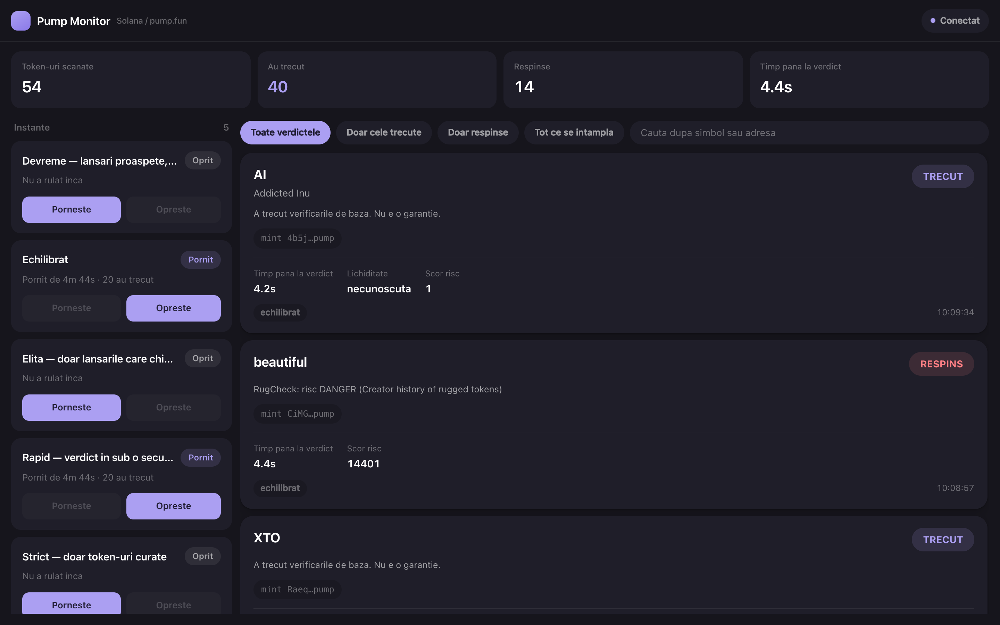

# pumpfun-monitor

Real-time monitor for new token launches on [pump.fun](https://pump.fun) (Solana), with a fail-fast anti-rug check pipeline and a live dashboard.



## Features

- Subscribes to the pump.fun program logs over WebSocket (`logsSubscribe`) and detects `Create` / `CreateV2`. Mint, name and symbol are read straight from the logs, with no extra RPC call.
- Fail-fast check pipeline, cheapest check first — a token that fails one stage never reaches the next:
  1. mint and freeze authority revoked (`getAccountInfo`, on-chain)
  2. liquidity, volume and FDV (DexScreener)
  3. second opinion from RugCheck
- Four verdicts: `PASS`, `FAIL`, `PENDING` (too new to be indexed) and `ERROR` (could not decide — an RPC hiccup is never reported as a `FAIL` or a `PASS`).
- Several bot profiles run side by side as separate processes, each with its own thresholds (`backend/configs/*.json`). The backend starts, stops and restarts them.
- FastAPI + SQLite backend that stores every event and pushes it to the dashboard over WebSocket.
- Optional Telegram alert for every `PASS`.
- Built to keep running: WebSocket reconnect with backoff, RPC retries, bounded queues with drop counters, per-pipeline deadlines, automatic restart of crashed bots.
- 220 offline unit tests (RPC and HTTP mocked).

## Tech stack

Python 3.11+ · FastAPI · httpx · websockets · aiosqlite · solders · React 18 · Vite

```
┌──────────────┐  logsSubscribe  ┌─────────────┐  HTTP ingest  ┌──────────┐  WebSocket  ┌───────────┐
│  Solana RPC  │ ──────────────▶ │  bot (proc) │ ────────────▶ │ FastAPI  │ ──────────▶ │ dashboard │
└──────────────┘                 └─────────────┘               │ + SQLite │             └───────────┘
                                 (one per bot_id)              └──────────┘
```

## Getting started

Requirements: Python 3.11+ and Node 18+.

```bash
git clone https://github.com/vladiclick/pumpfun-monitor.git
cd pumpfun-monitor

cd backend
python3 -m venv .venv
.venv/bin/pip install -r requirements.txt
cp .env.example .env            # change INGEST_TOKEN
cd ../frontend
npm install
cd ..

./start.sh                      # backend on :8000, dashboard on :5173
```

Open http://127.0.0.1:5173 and start a profile from the left panel.

The default RPC is the public `api.mainnet-beta.solana.com`, which is heavily rate-limited. A free [Helius](https://www.helius.dev) key works much better — see `backend/.env.example`.

Run one bot without the dashboard:

```bash
cd backend
.venv/bin/python -m bot.runner --config configs/rapid.json
```

Run the tests:

```bash
cd backend
.venv/bin/python -m unittest discover -s tests -t .
```

## Bot profiles

| Profile | What it checks | Telegram |
|---|---|---|
| `rapid` | on-chain authorities only — verdict in under a second | off |
| `echilibrat` (balanced) | on-chain + liquidity + RugCheck — the recommended defaults | off |
| `strict` | high liquidity threshold, RugCheck fail-closed | off |
| `devreme` (early) | reads live trades from the logs, 30 s window — very early, high risk | on |
| `elita` | watches for 2 hours, alerts only past $80k market cap with real activity | on |

## Measured numbers

Measured live on mainnet, on a MacBook Air M4:

| | |
|---|---|
| detection → verdict, on-chain only | 37–550 ms |
| detection → verdict, full pipeline | 2.1–2.7 s |
| pump.fun log volume handled | ~1,400 messages/s |
| hot-path cost | 1.6 µs per message (0.2 % of one core) |
| worst event-loop stall under full load | 3 ms |

## Status

Working; I run it locally. The UI and code comments are in Romanian. Full documentation — every config key, the REST/WebSocket API, exposing the dashboard through Cloudflare Tunnel, troubleshooting — is in [docs/README.ro.md](docs/README.ro.md).

It is a monitoring tool, not trading advice. It never signs transactions or touches a wallet.

## License

[MIT](LICENSE)
